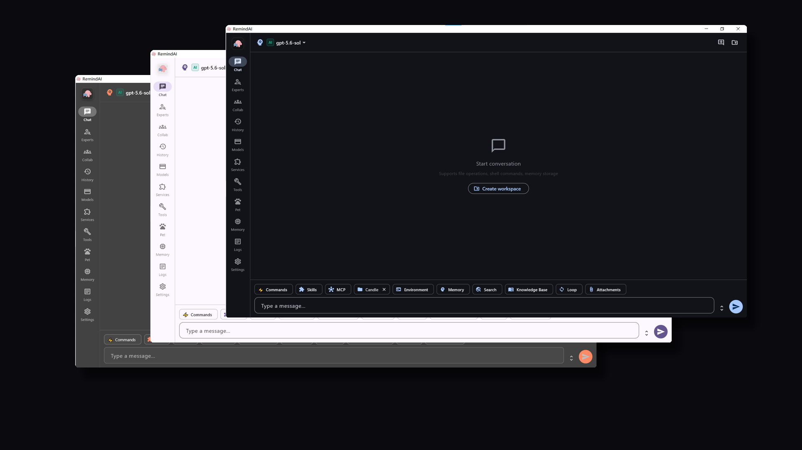

<div align="center">
  
  <h1>🧠 RemindAI</h1>
  <p><strong>开源桌面 AI 助手，不再只是对话</strong></p>
  <p>
    <a href="README_EN.md">🌐 English</a> |
    <a href="https://github.com/PythonnotJava/RemindAI/releases">📦 下载</a> |
  </p>
  <p>
    
    
    
       
    
    
    
  </p>
</div>

---

<p align="center">
  
</p>

---

## 🚀 快速开始

### 📥 下载

前往 [Releases](https://github.com/PythonnotJava/RemindAI/releases) 下载预编译包：

| 平台 | 状态 | 说明 |
|---|---|---|
| 💻 Windows | ✅ 正式支持 | 提供安装包 |
| 🐧 Linux | 🔧 自行编译 | 源码构建即可使用 |
| 🍎 macOS | 🔧 自行编译 | 源码构建即可使用 |

### 🔨 从源码构建

```bash
# 环境要求: Flutter SDK >= 3.12.1
git clone https://github.com/PythonnotJava/RemindAI.git
cd RemindAI

# 版本号的唯一来源是 pubspec.yaml；改完版本后同步 Dart 侧常量
# （test/settings/version_sync_test.dart 会守护两者一致，忘了跑会红）
dart run tool/sync_version.dart

# Windows
flutter build windows --release --tree-shake-icons --split-debug-info=./debug-info

# Linux 
flutter build linux --release --tree-shake-icons --split-debug-info=./debug-info
# macOS
flutter create --platforms=macos
flutter build macos --release --tree-shake-icons --split-debug-info=./debug-info
```

### 指导

- [☞点这里获取快速指导](how_to_use.md)
- [☞点这里获取RemindAI的优化方案](future_guide.md)

---


## 💡 渠道推荐

### 🏀 Kuncode中转站

如果你正在寻找一个稳定、便捷的 AI 模型 API 中转服务，不妨了解一下 **Kuncode**！

**Kuncode** 致力于提供优质的模型 API 服务，支持 24 小时不间断运行，满足日常开发、AI 应用搭建、程序调试以及各类模型调用需求。

**✨ 推荐理由**

- **24H 不间断服务**：提供全天候 API 服务，减少调用中断带来的影响。
- **优质模型 API**：为开发者提供便捷的模型 API 接入渠道。
- **便捷接入**：适用于 AI 应用开发、自动化工作流及各类项目集成。
- **开发友好**：为有模型 API 调用需求的个人开发者和团队提供更多选择。

🔗 **官方入口：** https://kuncode.120403.xyz/

无论是日常 AI 开发，还是项目中的模型 API 集成，都可以了解一下 Kuncode。

---


## 🙏 致谢

感谢 **Yu** 为 RemindAI 设计了精巧灵动的 Logo，为产品注入了鲜活的生命力。

---

## 优化参考
- [https://arxiv.org/pdf/2606.24775](https://arxiv.org/pdf/2606.24775)，感谢该文章精确指出了记忆类架构的已知薄弱环节——缺乏版本管理导致检索到过时事实

## 旅程

RemindAI创建于2026.03，现在完全由自身和其他Agent维护且不在发布新的编译版本，为了工作需要我可能会更新且可能偶尔同步一下源代码。 

## 📄 许可证

[MIT License](./LICENSE) — Copyright (c) 2026 PythonnotJava

<div align="center">
  <sub>用 Flutter 和热情构建 ❤️</sub>
</div>
