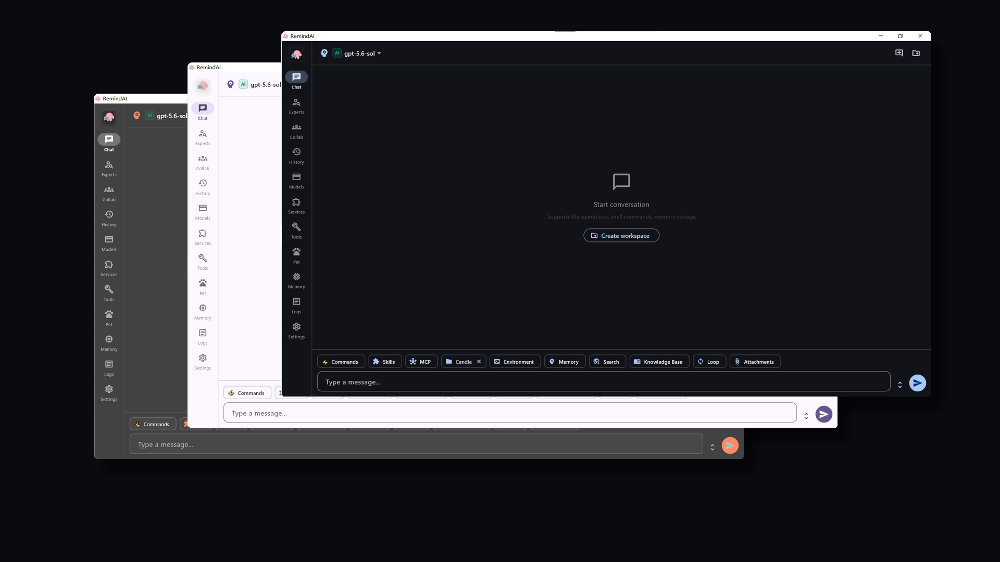

<div align="center">
  
  <h1>🧠 RemindAI</h1>
  <p><strong>An open-source desktop AI assistant — more than just chat</strong></p>
  <p>
    <a href="README.md">🌐 中文</a> |
    <a href="https://github.com/PythonnotJava/RemindAI/releases">📦 Download</a> |
  </p>
  <p>
    
    
    
    
    
    
    
  </p>
</div>

---

<p align="center">
  
</p>

---

## 🚀 Getting Started

### 📥 Download

Get a prebuilt package from [Releases](https://github.com/PythonnotJava/RemindAI/releases):

| Platform | Status | Notes |
|---|---|---|
| 💻 Windows | ✅ Officially supported | Prebuilt installer provided |
| 🐧 Linux | 🔧 Build it yourself | Just build from source |
| 🍎 macOS | 🔧 Build it yourself | Just build from source |

### 🔨 Build from Source

```bash
# Requirements: Flutter SDK >= 3.12.1
git clone https://github.com/PythonnotJava/RemindAI.git
cd RemindAI

# pubspec.yaml is the single source of truth for the version; after bumping it,
# sync the Dart-side constant (test/settings/version_sync_test.dart guards them)
dart run tool/sync_version.dart

# Windows
flutter build windows --release --tree-shake-icons --split-debug-info=./debug-info

# Linux
flutter build linux --release --tree-shake-icons --split-debug-info=./debug-info
# macOS
flutter create --platforms=macos
flutter build macos --release --tree-shake-icons --split-debug-info=./debug-info
```

### Guides

- [☞ Quick-start guide](how_to_use.md) (Chinese)
- [☞ RemindAI optimization roadmap](future_guide.md) (Chinese)

---

## 💡 Recommended Channels

### 🏀 Kuncode API Gateway

If you are looking for a stable and convenient API gateway for AI models, consider checking out **Kuncode**!

**Kuncode** is dedicated to providing high-quality model API services. It operates 24/7, supporting your needs for daily development, AI application building, program debugging, and various model-based tasks.

**✨ Why Choose Kuncode?**

- **24/7 Continuous Service**: Reliable, round-the-clock API access to minimize service interruptions.
- **High-Quality Model APIs**: Offers developers a seamless way to access various AI models.
- **Easy Integration**: Well-suited for AI application development, automated workflows, and project integrations.
- **Developer-Friendly**: Provides a great option for individual developers and teams who need to integrate AI model APIs.

🔗 **Official Website:** https://kuncode.120403.xyz/

Whether you are working on daily AI development or integrating model APIs into your projects, Kuncode is worth a look.

---

## 🙏 Acknowledgments

Thanks to **Yu** for designing RemindAI's refined, agile logo — it gives the product a life of its own.

---

## Optimization Reference
- [https://arxiv.org/pdf/2606.24775](https://arxiv.org/pdf/2606.24775) — thanks to this paper for precisely identifying a known weak spot in memory architectures: without version management, retrieval surfaces stale facts.

## Journey

RemindAI was created in March 2026. It is now maintained entirely by itself and other agents; no new compiled versions will be released. I may, however, update it or occasionally synchronize the source code as required for my work.

## 📄 License

[MIT License](./LICENSE) — Copyright (c) 2026 PythonnotJava

<div align="center">
  <sub>Built with Flutter and passion ❤️</sub>
</div>
